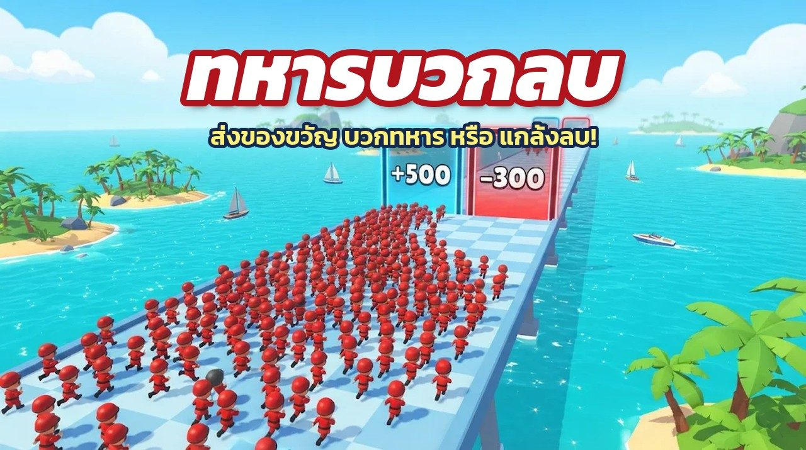
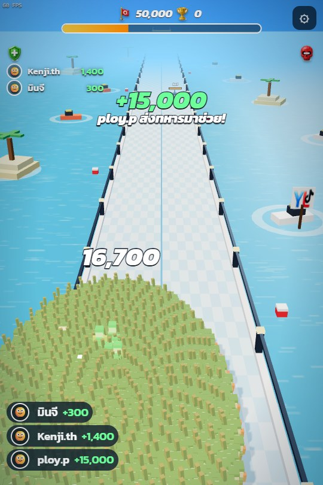
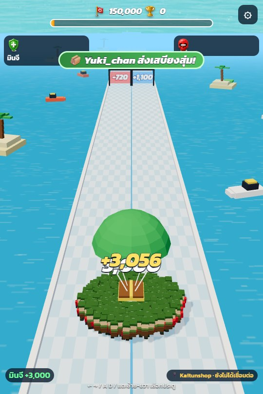
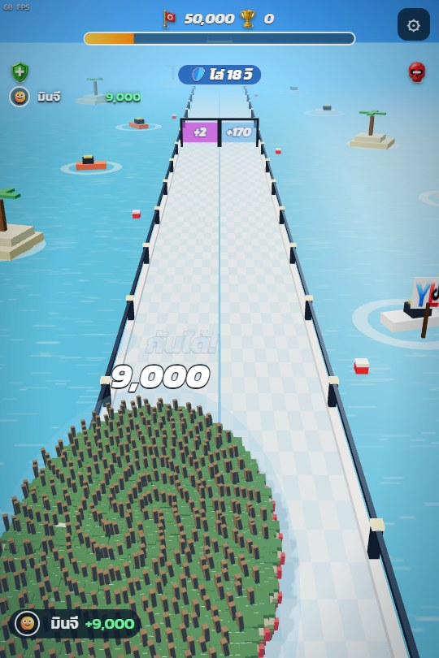
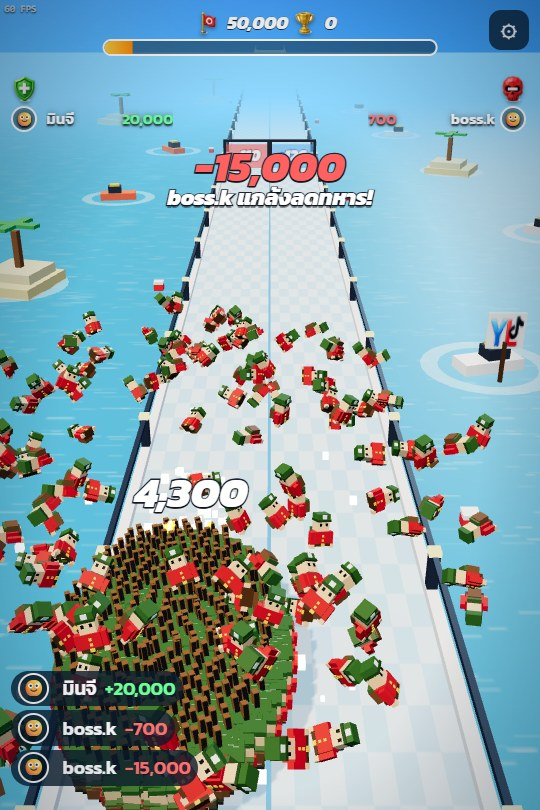
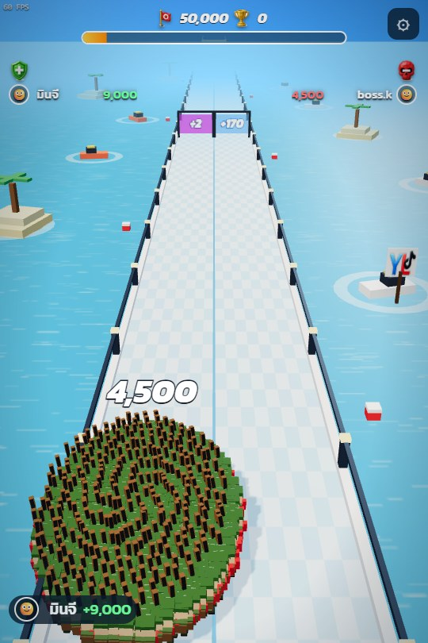
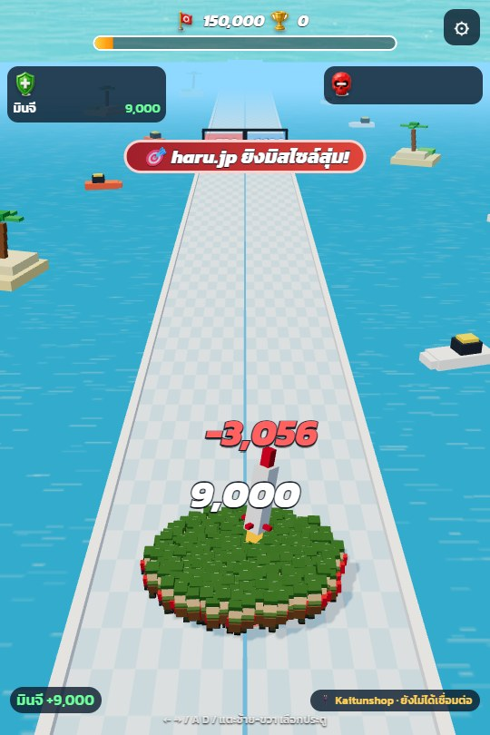

# ทหารบวกลบ (Army ±) — gift commands

**A YL game** (YL Entertainment licence) · runs on **Kaitunshop** (web game) · not part of AVO Play.

A TikTok live gate runner: the streamer steers the army through + / − gates; viewers' gifts add soldiers (help) or remove them
(prank, the count can go below zero). Reach the target (150,000 by default) and hold it for 15 s to win. This repo is the command
page only — each gift command with a short clip of what it does in the game, plus the Kaitunshop preset and its pictures.

**Page:** https://command-by-avo.github.io/army-commands/

| บวก | สุ่มช่วย | โล่ | ลบ | ระเบิด | สุ่มแกล้ง |
|---|---|---|---|---|---|
|  |  |  |  |  |  |

## Commands
- `plus N` — add N soldiers · `minus N` — remove N (can go negative)
- `bomb N` — a bomb drops on the army: −N
- `shield S` — a shield dome for S seconds: no losses at all
- `random plus LO HI` / `random minus LO HI` — สุ่มช่วย (a supply crate on a parachute) / สุ่มแกล้ง (a missile on a target ring): a counter races to a LO..HI result as it lands

## Kaitunshop preset
[`army-kaitunshop-preset.json`](army-kaitunshop-preset.json) — import it in Kaitunshop: แดชบอร์ด → นำเข้า / ส่งออกโปรไฟล์.
Each game action: eventName = the command's first word, payload = `{"cmd": "<full command>"}`.

Part of [Command BY AVO](https://github.com/Command-BY-AVO) — one page per game, gift commands + clips.
